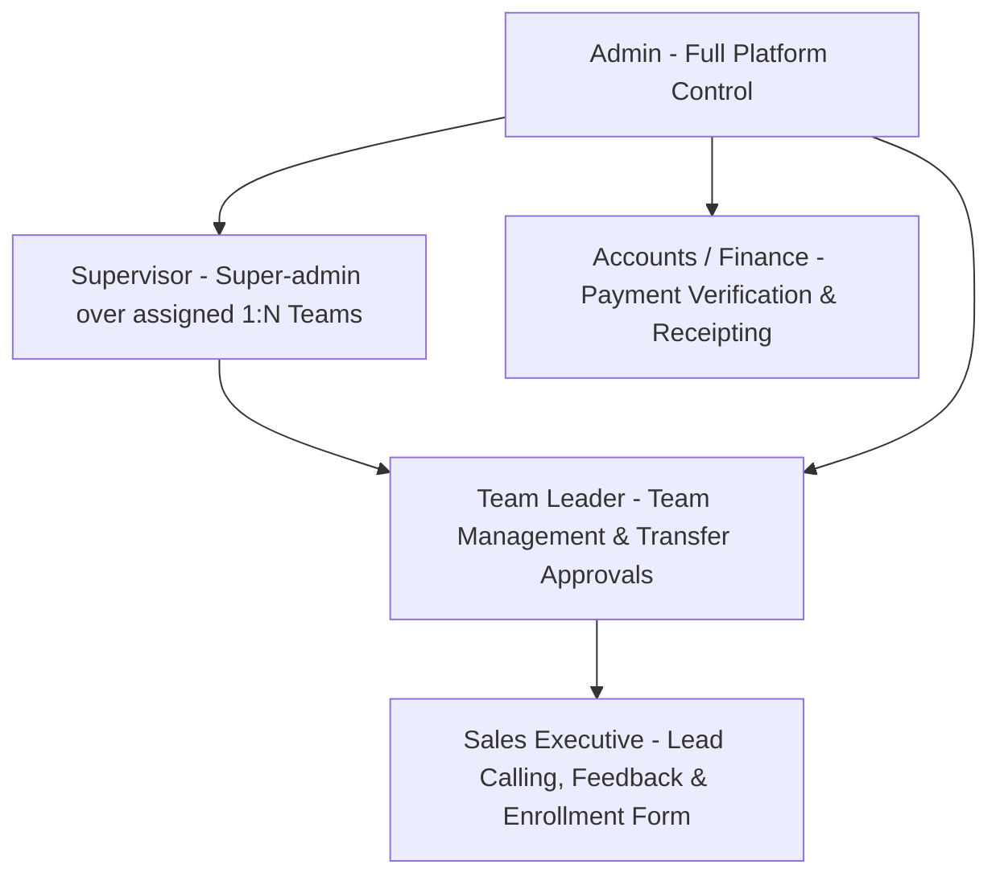
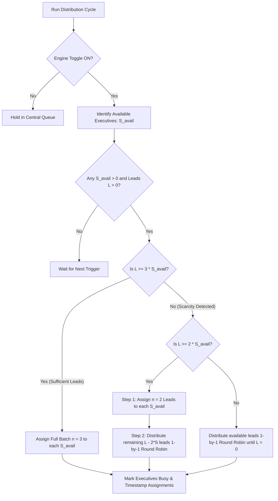
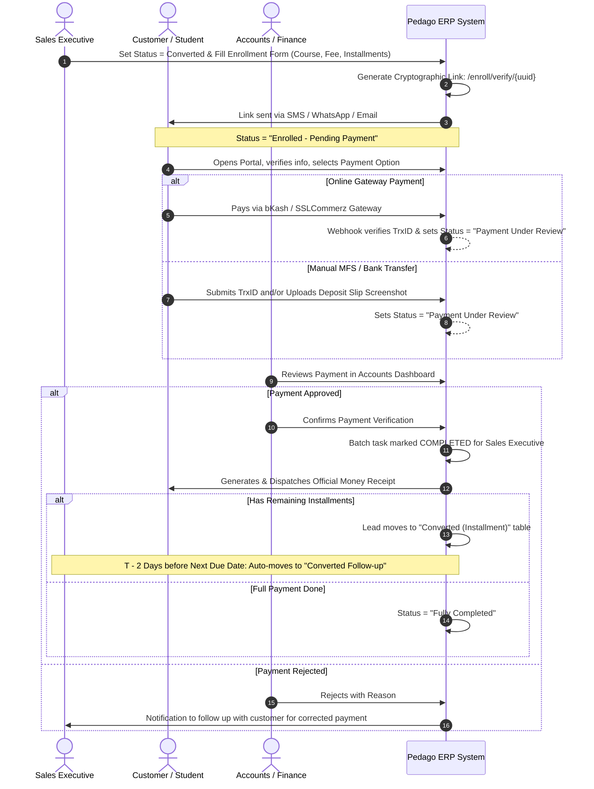

# Sales Lead Distribution & Management Module (v-03)

**Product Requirement & Comprehensive Functional Specification**  
**Version:** 3.0 (Final Architecture & Logic Specification)  
**Target Environment:** Pedago Academy ERP  
**Database:** MySQL (`pedago_erp_db`) | **Backend:** Laravel 13 on PHP 8.5 | **Frontend:** Blade + Tailwind CSS v4  
**Date:** October 2026  

---

## 1. Module Overview & Executive Summary

The **Sales Lead Distribution & Management Module** of Pedago Academy ERP is an enterprise-grade EdTech sales engine designed to manage the entire lifecycle of a sales lead: from multi-channel ingestion, intelligent duplicate resolution, dynamic shift-based batch distribution, and activity enforcement, to student enrollment, installment tracking, automated payment gateway verification, and finance accounts reconciliation.

### Core Value Propositions
1. **Absolute Ownership & Accountability:** Strict "One Lead → One Active Owner" principle prevents lead poaching and ensures total visibility.
2. **Fair & Intelligent Batch Distribution:** $n$-Lead Batch Model (Default $n=3$) with automatic scarcity degradation ($n=2 \rightarrow$ 1-by-1 Round Robin) when lead volume drops below threshold.
3. **Automated Conversion & Installment Pipeline:** Bridges sales conversion directly into student registration, customer self-verification, bKash/SSLCommerz/Manual payment processing, installment due alerts ($T-2$ days), and Accounts sign-off.
4. **Resilient Non-Freezing Operations:** Dual-approval cross-team transfers with 7-day auto-transfer fallbacks, automated "Lazy" employee demotions, and zero operational bottlenecks.

---

## 2. Roles, Hierarchy & Permission Matrix

The system governs 5 distinct roles in a strict hierarchy:



| Role | Hierarchy Level | Primary Responsibilities & Permitted Actions | Restricted Boundaries |
| :--- | :--- | :--- | :--- |
| **Admin** | Level 1 (Global) | • Global System Configuration ($n$ batch size, engine ON/OFF toggle, shift schedules, grace periods).<br>• Manage all teams, supervisors, team leaders, agents, and accounts personnel.<br>• Full oversight of all leads, unassigned queues, duplicate review queue, reports, and reassignment.<br>• Override any transfer, lead status, or shift restriction. | None. Full system access. |
| **Supervisor** | Level 2 (Multi-Team) | • **1:N Team Relationship**: Supervises multiple designated teams assigned explicitly by Admin.<br>• Equivalent to Admin within their assigned teams: inspect leads, view overdue queues, resolve duplicates, and approve cross-team transfers.<br>• Access team-wise sales performance and conversion metrics. | Cannot alter global system configuration or access teams outside their assigned scope. |
| **Team Leader** | Level 3 (Single Team) | • Manage and monitor executives within their own assigned team.<br>• Monitor active batches, due follow-ups, and overdue follow-ups.<br>• Approve or reject lead transfer requests (acting as Sender TL or Receiver TL).<br>• Manual lead reassignment for team members on leave/unavailable. | Cannot view or modify leads belonging to other teams unless involved in a cross-team transfer request. |
| **Sales Executive** | Level 4 (Execution) | • View and work on only currently assigned $n$-Lead Batch and personal Follow-up tasks.<br>• Mandatory feedback submission post-contact.<br>• Request lead transfer with mandatory reason.<br>• Generate student enrollment and installment breakdown forms upon conversion.<br>• View past course inquiries strictly for actively assigned contacts. | Cannot browse global lead tables, view other executives' leads, or delete any history/record. |
| **Accounts / Finance** | Specialized Dept | • Review customer payments in "Payment Under Review" state.<br>• Verify bank deposits, bKash / SSLCommerz gateway TrxIDs, and manual transaction slips.<br>• Approve payment (marks lead batch task complete & issues Money Receipt) or Reject payment (with reason for sales correction). | Cannot reassign leads or modify sales feedback. |

---

## 3. Global System Settings & Operational Controls

Stored in the `system_settings` table, configurable via the Admin Settings Dashboard:

1. **`lead_distribution_engine_active` (Boolean, Default: `true`):**
   - Master Kill-Switch / Toggle in Admin Dashboard.
   - When `false`, automated batch push is paused. Leads accumulate in the Central Queue. Existing assigned batches continue unaffected.
2. **`default_batch_size_n` (Integer, Default: `3`):**
   - Single global configuration determining the standard batch size for sales executives.
3. **`shift_cutoff_minutes` (Integer, Default: `30`):**
   - Minutes before an executive's shift ends when new batch distribution automatically stops for that individual.
4. **`overdue_followup_lazy_threshold_t` (Integer/Hours, Default: `24` hours or `2` consecutive working days):**
   - Elapsed overdue time without feedback before an executive is penalized with status `Lazy`.
5. **`transfer_auto_approval_days` (Integer, Default: `7`):**
   - If a cross-team transfer is pending approval for 7 calendar days, system automatically approves and executes the transfer.
6. **`installment_followup_lead_days` (Integer, Default: `2`):**
   - Days before an installment due date ($T-2$) when the lead automatically enters the `Converted Follow-up` queue.

---

## 4. Employee Shift, Roster & Availability Engine

Sales executives do not operate on a fixed identical schedule. The system incorporates a dynamic roster model.

### 4.1 Shift Attributes (per employee in `user_shifts` table)
* `shift_start_time` (e.g., `10:00:00` or `14:00:00`)
* `shift_end_time` (e.g., `18:00:00` or `22:00:00`)
* `is_on_duty_today` (Boolean: toggle based on weekly roster / leave status)
* `cutoff_time` = `shift_end_time` - `shift_cutoff_minutes` (e.g., 5:30 PM for a 6:00 PM shift end)

### 4.2 Availability Status State Machine

| Status | Distribution Eligibility | Definition & Trigger Conditions |
| :--- | :---: | :--- |
| **`Available`** | **ELIGIBLE** | Executive is on duty (`is_on_duty_today = true`), current time is within `[shift_start_time, cutoff_time]`, and current batch is completed (0 active batch tasks). |
| **`Busy`** | Ineligible | Currently has an active incomplete batch ($1 \le \text{active\_tasks} \le n$). |
| **`Unavailable`** | Ineligible | Temporarily paused by Team Leader/Admin (in meeting, training, or short break). |
| **`Off Duty`** | Ineligible | Outside shift working window, past cutoff time, or on scheduled weekly day off. |
| **`Lazy`** | **BLOCKED** | Auto-triggered when scheduled follow-ups are overdue past threshold $t$ without action. Blocked from receiving new batches until cleared. |
| **`Resigned`** | **PERMANENT BLOCK** | Former employee. Never receives leads. All historical ownership archived; unworked leads rerouted to Central Queue. |

### 4.3 Recovery from `Lazy` Status
An employee in `Lazy` status is restored to `Available` when:
1. They submit overdue feedback on all pending follow-up tasks, **OR**
2. Team Leader / Supervisor manually reviews and clears the restriction via Admin Override.

---

## 5. Lead Ingestion & Smart EdTech Duplicate Matrix

### 5.1 Ingestion Sources (Phase 1)
1. **Bulk Excel/CSV Upload:** Admin uploads spreadsheets with standardized column mapping (Customer Name, Phone, Alt Phone, Email, City, Course, Campaign, Source).
2. **Manual Single Lead Entry:** Admin / Team Leader enters walk-in or offline event inquiries.

### 5.2 EdTech Smart Duplicate Matrix
In an EdTech environment, multiple inquiries from the same phone number can be legitimate (e.g., a parent enrolling two children, or a student inquiring about two different courses: Spoken English and Web Development).

```
New Ingestion Incoming
          │
          ▼
   Check Primary & Secondary Phone
          │
  ┌───────┴───────────────────────────────────────┐
  │                                               │
No Match                                     Phone Match Found
  │                                               │
  ▼                                               ▼
Valid New Lead                     Compare Name, Course & Campaign
(Sent to Central Queue)                           │
                           ┌──────────────────────┴──────────────────────┐
                           │                                             │
                   All 4 Match Exactly                            Any Attribute Differs
                 (Phone + Name + Course + Campaign)           (Different Course / Child / Alt-Phone)
                           │                                             │
                           ▼                                             ▼
                 Definite Duplicate                            Potential Valid Inquiry
                 (Auto-flagged & Suppressed)                 (Routed to Admin Review Queue)
                                                                         │
                                                       Admin/Supervisor Manual Actions:
                                                       1. Approve as Separate Valid Lead
                                                       2. Merge with Active Lead
                                                       3. Mark Duplicate & Discard
                                                       4. Edit Info & Dispatch
```

---

## 6. Lead Distribution Engine & Batch Allocation Algorithm

### 6.1 Algorithm Execution Conditions
The distribution engine runs automatically whenever:
1. `lead_distribution_engine_active == true` AND
2. New leads enter the Central Unassigned Queue (`status = 'New'`), OR
3. An executive completes their current batch and transitions to `Available`.

### 6.2 Dynamic Batch Scarcity Allocation Model
To ensure fairness when incoming lead volume fluctuates, the engine calculates the ratio of available queue leads $L$ to available on-duty sales executives $S_{\text{avail}}$:



#### Exact Mathematical Logic:
1. Let $L$ = Total Unassigned Leads in Central Queue.
2. Let $S_{\text{avail}}$ = Count of Executives with status `Available` and `current_time <= cutoff_time`.
3. **Case 1: $L \ge n \times S_{\text{avail}}$ (Abundant Supply):**
   - Each executive receives standard batch $n = 3$.
4. **Case 2: $2 \times S_{\text{avail}} \le L < 3 \times S_{\text{avail}}$ (Moderate Scarcity):**
   - **Step 1:** Every executive receives $n = 2$ leads.
   - **Step 2:** The remaining $R = L - (2 \times S_{\text{avail}})$ leads are distributed **1 lead per person Round Robin** based on longest idle time until $R = 0$.
5. **Case 3: $L < 2 \times S_{\text{avail}}$ (Severe Scarcity):**
   - Leads are distributed **1 lead per person Round Robin** until leads are exhausted.

---

## 7. Lead Action, Mandatory Feedback & Follow-up Queue Isolation

### 7.1 Mandatory Feedback Submission
An executive cannot dismiss a lead without submitting a structured feedback record:

* **Call Status:** `Connected`, `Not Connected`, `Busy`, `Call Later`, `Wrong Number`, `Connected WhatsApp`, `Under Age`, `Over Age`
* **Customer Interest:** `Highly Interested`, `Interested`, `Maybe`, `Not Interested`, `Decision Pending`
* **Customer Concern:** Open text (Customer requirements, objections, notes)
* **Sales Note:** Open text summary
* **Next Action:** 
  1. `Follow-up` (Mandates: `followup_date`, `followup_time`)
  2. `Converted` (Triggers Enrollment & Installment workflow)
  3. `Not Interested` (Lead closed)
  4. `Unreachable` (Recorded attempts)
  5. `Lost` (Reason specified)

### 7.2 Follow-up Queue Isolation Rule
* When Next Action is set to `Follow-up`:
  - The lead is **immediately unlinked** from the active batch tasks table and moved into the isolated `lead_followups` queue.
  - The active batch count decrements: if this was the last pending lead in the batch, the batch is marked **Completed**, and the executive becomes `Available` for a new batch.
  - Follow-up leads do **not** block new batch assignments unless they become `Overdue` past threshold $t$.

---

## 8. Overdue Follow-up & The "Lazy" Penalty Rule

1. When a scheduled follow-up reaches its `followup_date_time`, it surfaces in the executive's `Follow-up Due` tab.
2. If `current_time > followup_date_time + overdue_followup_lazy_threshold_t` (e.g., 24 hours overdue without any logged call attempt or feedback update):
   - Executive's availability status is automatically updated to **`Lazy`**.
   - An alert is dispatched to their Team Leader and Supervisor dashboard.
   - The executive is barred from receiving any new batch leads until the overdue backlog is resolved.

---

## 9. Conversion, Student Enrollment, Installment & Accounts Workflow

This workflow represents the complete bridge from Sales to Student Admission and Finance.



### 9.1 Lead Status Milestones during Conversion
1. **`Enrolled - Pending Payment`**: Executive generated form and link; customer has not yet completed payment submission. (Active batch slot **remains occupied**).
2. **`Payment Under Review`**: Customer submitted payment via Gateway or Manual TrxID/Slip; awaiting Accounts verification. (Active batch slot **remains occupied**).
3. **`Payment Approved & Verified`**: Accounts confirms receipt.
   - **Batch Impact:** Executive's batch task is **officially completed and released**.
   - **Single Payment:** Lead status becomes `Fully Completed`.
   - **Installment Payment:** Lead status moves to `Converted (Installment)`.

### 9.2 Installment Tracking & Automated $T-2$ Alerts
* If course fee is ৳15,000 in 3 installments:
  - Installment 1 (৳5,000): Paid now.
  - Installment 2 (৳5,000): Due on Nov 30.
  - Installment 3 (৳5,000): Due on Dec 30.
* **Automated Scheduler ($T-2$ Rule):** 2 days before due date (Nov 28), system automatically copies/promotes the installment task to the executive's **`Converted Follow-up`** dashboard with reminder notifications.
* Once the final installment is approved by Accounts, the enrollment is marked **`Fully Completed`**.

---

## 10. Payment Gateways & Manual Processing

### 10.1 Supported Channels (Phase 1)
1. **bKash Payment Gateway (Checkout URL / Direct API):**
   - Direct authorization and automated IPN/webhook callback handling.
2. **SSLCommerz Hosted Gateway:**
   - Multi-card, internet banking, and mobile wallet checkout with validation API callback.
3. **Manual Offline Payment (MFS / Bank Transfer):**
   - Customer enters: Payment Channel (bKash Personal/Merchant, Nagad, Rocket, Bank Account), Sent-from Phone/Account Number, Transaction ID (TrxID), and/or Payment Slip Screenshot.
   - **Rule:** Must provide at least one (TrxID OR Screenshot slip); optionally can provide both.

---

## 11. Cross-Team Lead Transfer Engine

### 11.1 Rules & Non-Freezing Lifecycle
* **Dual Approval Requirement:** Transfer across teams requires authorization from **both** the Sender's Team Leader and the Receiver's Team Leader.
* **Zero Operational Freeze:** 
  - While transfer is in `Pending Approval` state, the lead is **never frozen**.
  - The current owner (sender) retains full operational ownership, can place calls, add notes, and must work scheduled tasks.
* **Auto-Transfer Fallback (7-Day Rule):**
  - If a transfer request remains pending in approval state for 7 calendar days without rejection, the system's daily cron job automatically approves and executes the transfer.
* **Ownership Handoff:**
  - Upon approval (manual or auto): Active owner is updated to the recipient, all previous timeline history is transferred, and sender's access becomes read-only.

---

## 12. Restricted Lead Context Search & Anti-Poaching Architecture

To prevent lead stealing or unauthorized customer browsing while allowing necessary academic context:
* **No Global Free-Form Phone Search:** Executives cannot type random phone numbers into a global directory.
* **In-Context History Modal:** On the lead detail view of any lead currently assigned to an executive (either in active batch or follow-up list), a button titled **"View Past Inquiries & Course History"** is available.
* **Backend Verification:** Clicking this invokes `GET /api/v1/leads/{id}/customer-history`. The backend checks `LeadPolicy::viewCustomerHistory($user, $lead)`:
  - Verifies that `$lead->current_owner_id === $user->id`.
  - Queries all past leads having the same primary or secondary phone.
  - Returns past course inquiries, previous executive interaction logs, and admission notes.

---

## 13. Complete Database Schema (`pedago_erp_db`)

```sql
-- Database: pedago_erp_db
CREATE DATABASE IF NOT EXISTS `pedago_erp_db` CHARACTER SET utf8mb4 COLLATE utf8mb4_unicode_ci;
USE `pedago_erp_db`;

-- 1. System Settings & Configuration
CREATE TABLE `system_settings` (
    `id` BIGINT UNSIGNED AUTO_INCREMENT PRIMARY KEY,
    `key` VARCHAR(100) UNIQUE NOT NULL,
    `value` TEXT NOT NULL,
    `description` VARCHAR(255) NULL,
    `updated_at` TIMESTAMP DEFAULT CURRENT_TIMESTAMP ON UPDATE CURRENT_TIMESTAMP
);

-- 2. Teams Table
CREATE TABLE `teams` (
    `id` BIGINT UNSIGNED AUTO_INCREMENT PRIMARY KEY,
    `name` VARCHAR(100) NOT NULL,
    `team_leader_id` BIGINT UNSIGNED NULL,
    `created_at` TIMESTAMP NULL,
    `updated_at` TIMESTAMP NULL
);

-- 3. Supervisor Teams (1:N Relationship)
CREATE TABLE `supervisor_teams` (
    `id` BIGINT UNSIGNED AUTO_INCREMENT PRIMARY KEY,
    `supervisor_id` BIGINT UNSIGNED NOT NULL,
    `team_id` BIGINT UNSIGNED NOT NULL,
    `created_at` TIMESTAMP DEFAULT CURRENT_TIMESTAMP,
    UNIQUE KEY `unique_supervisor_team` (`supervisor_id`, `team_id`)
);

-- 4. User Shifts & Roster Table
CREATE TABLE `user_shifts` (
    `id` BIGINT UNSIGNED AUTO_INCREMENT PRIMARY KEY,
    `user_id` BIGINT UNSIGNED NOT NULL UNIQUE,
    `shift_start_time` TIME NOT NULL DEFAULT '10:00:00',
    `shift_end_time` TIME NOT NULL DEFAULT '18:00:00',
    `is_on_duty_today` BOOLEAN DEFAULT TRUE,
    `availability_status` ENUM('Available', 'Busy', 'Unavailable', 'Off Duty', 'Lazy', 'Resigned') DEFAULT 'Off Duty',
    `last_active_at` TIMESTAMP NULL,
    `created_at` TIMESTAMP NULL,
    `updated_at` TIMESTAMP NULL
);

-- 5. Courses / Products Table
CREATE TABLE `courses` (
    `id` BIGINT UNSIGNED AUTO_INCREMENT PRIMARY KEY,
    `title` VARCHAR(150) NOT NULL,
    `code` VARCHAR(50) UNIQUE NOT NULL,
    `base_fee` DECIMAL(10,2) NOT NULL,
    `is_active` BOOLEAN DEFAULT TRUE,
    `created_at` TIMESTAMP NULL,
    `updated_at` TIMESTAMP NULL
);

-- 6. Core Leads Table
CREATE TABLE `leads` (
    `id` BIGINT UNSIGNED AUTO_INCREMENT PRIMARY KEY,
    `lead_code` VARCHAR(50) UNIQUE NOT NULL,
    `customer_name` VARCHAR(150) NOT NULL,
    `primary_phone` VARCHAR(25) NOT NULL,
    `alternate_phone` VARCHAR(25) NULL,
    `email` VARCHAR(120) NULL,
    `location` VARCHAR(150) NULL,
    `student_age` INT UNSIGNED NULL,
    `academic_background` VARCHAR(150) NULL,
    `interested_course_id` BIGINT UNSIGNED NULL,
    `lead_source` VARCHAR(50) NOT NULL,
    `campaign_name` VARCHAR(100) NULL,
    `status` ENUM('New', 'Assigned', 'Contacted', 'Follow-up', 'Interested', 'Enrolled - Pending Payment', 'Payment Under Review', 'Converted', 'Not Interested', 'Unreachable', 'Lost') DEFAULT 'New',
    `current_owner_id` BIGINT UNSIGNED NULL,
    `team_id` BIGINT UNSIGNED NULL,
    `assigned_at` TIMESTAMP NULL,
    `last_contacted_at` TIMESTAMP NULL,
    `created_at` TIMESTAMP NULL,
    `updated_at` TIMESTAMP NULL,
    INDEX `idx_phones` (`primary_phone`, `alternate_phone`),
    INDEX `idx_status_owner` (`status`, `current_owner_id`)
);

-- 7. Batches Table
CREATE TABLE `lead_batches` (
    `id` BIGINT UNSIGNED AUTO_INCREMENT PRIMARY KEY,
    `user_id` BIGINT UNSIGNED NOT NULL,
    `batch_size` INT UNSIGNED NOT NULL DEFAULT 3,
    `status` ENUM('Active', 'Completed') DEFAULT 'Active',
    `assigned_at` TIMESTAMP DEFAULT CURRENT_TIMESTAMP,
    `completed_at` TIMESTAMP NULL
);

-- 8. Batch Items (Connects Leads to Batches)
CREATE TABLE `lead_batch_items` (
    `id` BIGINT UNSIGNED AUTO_INCREMENT PRIMARY KEY,
    `batch_id` BIGINT UNSIGNED NOT NULL,
    `lead_id` BIGINT UNSIGNED NOT NULL,
    `is_completed` BOOLEAN DEFAULT FALSE,
    `action_taken` VARCHAR(50) NULL,
    `completed_at` TIMESTAMP NULL,
    UNIQUE KEY `unique_batch_lead` (`batch_id`, `lead_id`)
);

-- 9. Lead Actions & Feedbacks (Immutable History)
CREATE TABLE `lead_feedbacks` (
    `id` BIGINT UNSIGNED AUTO_INCREMENT PRIMARY KEY,
    `lead_id` BIGINT UNSIGNED NOT NULL,
    `user_id` BIGINT UNSIGNED NOT NULL,
    `call_status` VARCHAR(50) NOT NULL,
    `customer_interest` VARCHAR(50) NOT NULL,
    `customer_concern` TEXT NULL,
    `sales_note` TEXT NOT NULL,
    `next_action` VARCHAR(50) NOT NULL,
    `created_at` TIMESTAMP DEFAULT CURRENT_TIMESTAMP
);

-- 10. Follow-ups Queue Table
CREATE TABLE `lead_followups` (
    `id` BIGINT UNSIGNED AUTO_INCREMENT PRIMARY KEY,
    `lead_id` BIGINT UNSIGNED NOT NULL,
    `user_id` BIGINT UNSIGNED NOT NULL,
    `followup_date_time` DATETIME NOT NULL,
    `note` TEXT NULL,
    `is_done` BOOLEAN DEFAULT FALSE,
    `overdue_alert_sent` BOOLEAN DEFAULT FALSE,
    `created_at` TIMESTAMP NULL,
    `updated_at` TIMESTAMP NULL,
    INDEX `idx_due_time` (`followup_date_time`, `is_done`)
);

-- 11. Transfers Table (Dual Approval Engine)
CREATE TABLE `lead_transfers` (
    `id` BIGINT UNSIGNED AUTO_INCREMENT PRIMARY KEY,
    `lead_id` BIGINT UNSIGNED NOT NULL,
    `from_user_id` BIGINT UNSIGNED NOT NULL,
    `to_user_id` BIGINT UNSIGNED NOT NULL,
    `from_team_id` BIGINT UNSIGNED NOT NULL,
    `to_team_id` BIGINT UNSIGNED NOT NULL,
    `reason` TEXT NOT NULL,
    `sender_tl_approved_at` TIMESTAMP NULL,
    `sender_tl_user_id` BIGINT UNSIGNED NULL,
    `receiver_tl_approved_at` TIMESTAMP NULL,
    `receiver_tl_user_id` BIGINT UNSIGNED NULL,
    `is_auto_transferred` BOOLEAN DEFAULT FALSE,
    `status` ENUM('Pending', 'Approved', 'Rejected') DEFAULT 'Pending',
    `created_at` TIMESTAMP DEFAULT CURRENT_TIMESTAMP,
    `updated_at` TIMESTAMP NULL
);

-- 12. Enrollments Table
CREATE TABLE `enrollments` (
    `id` BIGINT UNSIGNED AUTO_INCREMENT PRIMARY KEY,
    `lead_id` BIGINT UNSIGNED NOT NULL UNIQUE,
    `course_id` BIGINT UNSIGNED NOT NULL,
    `sales_executive_id` BIGINT UNSIGNED NOT NULL,
    `secure_uuid` VARCHAR(64) UNIQUE NOT NULL,
    `student_name` VARCHAR(150) NOT NULL,
    `student_phone` VARCHAR(25) NOT NULL,
    `student_email` VARCHAR(120) NULL,
    `guardian_name` VARCHAR(150) NULL,
    `guardian_phone` VARCHAR(25) NULL,
    `base_course_fee` DECIMAL(10,2) NOT NULL,
    `discount_percentage` DECIMAL(5,2) DEFAULT 0.00,
    `final_deal_amount` DECIMAL(10,2) NOT NULL,
    `total_installments` INT UNSIGNED DEFAULT 1,
    `status` ENUM('Pending Payment', 'Payment Under Review', 'Enrolled', 'Cancelled') DEFAULT 'Pending Payment',
    `created_at` TIMESTAMP NULL,
    `updated_at` TIMESTAMP NULL
);

-- 13. Installment Schedules Table
CREATE TABLE `installment_schedules` (
    `id` BIGINT UNSIGNED AUTO_INCREMENT PRIMARY KEY,
    `enrollment_id` BIGINT UNSIGNED NOT NULL,
    `installment_number` INT UNSIGNED NOT NULL,
    `due_amount` DECIMAL(10,2) NOT NULL,
    `due_date` DATE NOT NULL,
    `followup_generated` BOOLEAN DEFAULT FALSE,
    `status` ENUM('Pending', 'Under Review', 'Paid', 'Overdue') DEFAULT 'Pending',
    `paid_at` TIMESTAMP NULL,
    `created_at` TIMESTAMP NULL,
    `updated_at` TIMESTAMP NULL
);

-- 14. Payments & Transactions Table
CREATE TABLE `payments` (
    `id` BIGINT UNSIGNED AUTO_INCREMENT PRIMARY KEY,
    `enrollment_id` BIGINT UNSIGNED NOT NULL,
    `installment_schedule_id` BIGINT UNSIGNED NULL,
    `amount` DECIMAL(10,2) NOT NULL,
    `payment_method` ENUM('bKash', 'SSLCommerz', 'Manual Bank', 'Manual MFS') NOT NULL,
    `transaction_id` VARCHAR(100) NULL,
    `slip_screenshot_path` VARCHAR(255) NULL,
    `verified_by_user_id` BIGINT UNSIGNED NULL,
    `status` ENUM('Pending', 'Verified', 'Rejected') DEFAULT 'Pending',
    `rejection_reason` TEXT NULL,
    `verified_at` TIMESTAMP NULL,
    `created_at` TIMESTAMP DEFAULT CURRENT_TIMESTAMP,
    `updated_at` TIMESTAMP NULL
);

-- 15. Duplicate Review Queue
CREATE TABLE `duplicate_lead_reviews` (
    `id` BIGINT UNSIGNED AUTO_INCREMENT PRIMARY KEY,
    `incoming_lead_data` JSON NOT NULL,
    `matched_lead_id` BIGINT UNSIGNED NOT NULL,
    `match_reason` VARCHAR(255) NOT NULL,
    `status` ENUM('Pending Review', 'Approved New', 'Merged', 'Discarded') DEFAULT 'Pending Review',
    `reviewed_by_user_id` BIGINT UNSIGNED NULL,
    `reviewed_at` TIMESTAMP NULL,
    `created_at` TIMESTAMP DEFAULT CURRENT_TIMESTAMP
);
```

---

## 14. Laravel Service Layer Architecture

The backend implementation will strictly follow the domain modular structure under `app/Modules/Lead/`:

```
app/
└── Modules/
    └── Lead/
        ├── Contracts/
        │   ├── DistributionEngineInterface.php
        │   ├── DuplicateDetectionInterface.php
        │   └── PaymentGatewayInterface.php
        ├── Services/
        │   ├── LeadDistributionEngine.php       // Batch calculation & scarcity distribution logic
        │   ├── DuplicateDetectionService.php    // Smart EdTech phone & course matching
        │   ├── LeadTransferService.php          // Dual TL approval & 7-day auto-transfer cron
        │   ├── EnrollmentService.php            // Cryptographic UUID & installment schedules
        │   └── PaymentVerificationService.php   // Gateway webhooks & Accounts approval
        ├── Gateways/
        │   ├── BkashPaymentGateway.php
        │   └── SslCommerzPaymentGateway.php
        └── Jobs/
            ├── RunAutomatedLeadDistributionJob.php
            ├── CheckOverdueFollowupsJob.php      // Flags Lazy status past threshold t
            ├── CheckPendingTransfersJob.php      // Auto-transfers after 7 days
            └── CheckUpcomingInstallmentsJob.php  // Triggers T-2 follow-ups
```

---

## 15. Acceptance Criteria Checklist (v-03 Verification)

1. [x] **Master Engine Toggle:** Admin can pause or resume automatic lead distribution with one click.
2. [x] **Batch & Scarcity Distribution:** Generates batches of $n=3$ when supply is ample, degrading cleanly to $n=2$ plus 1-by-1 Round Robin when $L < 3 \times S_{\text{avail}}$.
3. [x] **Dynamic Shifts:** Distribution cuts off 30 minutes before individual shift end time; pending leads carry forward without loss.
4. [x] **Lazy Penalty:** Failure to complete follow-ups within $t$ overdue hours auto-tags agent as `Lazy` and halts new lead inflow.
5. [x] **Follow-up Isolation:** Scheduling a follow-up date/time immediately unblocks the active batch slot.
6. [x] **End-to-End Conversion:** Lead conversion generates a secure link (`/enroll/verify/{uuid}`); Accounts payment verification formally finishes the batch task.
7. [x] **Dual Gateway + Manual Payments:** Supports bKash, SSLCommerz, and manual payments requiring TrxID, slip screenshot, or both.
8. [x] **Dual-Approved Transfers:** Cross-team transfers require both TLs' approval and auto-transfer after 7 days without freezing the lead.
9. [x] **Protected In-Context Search:** Agents can only inspect past course inquiries from within their actively assigned lead modal.
10. [x] **Immutable History:** Call logs, notes, transfers, and receipts are append-only and cannot be deleted.

---
*End of Functional Specification (v-03)*
