# Pedago Academy ERP — Database ER Diagram & Data Dictionary

**Database Target:** MySQL 8.x (`pedago_erp_db`)  
**Context:** Sales Lead Distribution & Management Module (v-03)  
**Encoding:** `utf8mb4_unicode_ci`  
**Date:** October 2026 (Updated with Extended HR & Lead Source Specifications)  

---

## 1. Visual Entity Relationship (ER) Diagram

```mermaid
erDiagram
    USERS ||--o{ TEAMS : "leads (1:1 optional)"
    USERS ||--o{ SUPERVISOR_TEAMS : "supervises (1:N)"
    TEAMS ||--o{ SUPERVISOR_TEAMS : "supervised_by (1:N)"
    USERS ||--|| USER_SHIFTS : "has_roster (1:1)"
    
    LEADS_SOURCE ||--o{ LEADS : "originates_from (1:N)"
    TEAMS ||--o{ LEADS : "assigned_to_team (1:N)"
    USERS ||--o{ LEADS : "owns_currently (1:N)"
    COURSES ||--o{ LEADS : "interested_in (1:N)"
    
    USERS ||--o{ LEAD_BATCHES : "receives_batch (1:N)"
    LEAD_BATCHES ||--o{ LEAD_BATCH_ITEMS : "contains_items (1:N)"
    LEADS ||--o{ LEAD_BATCH_ITEMS : "batched_in (1:N)"
    
    LEADS ||--o{ LEAD_FEEDBACKS : "has_activity_history (1:N)"
    USERS ||--o{ LEAD_FEEDBACKS : "logged_by (1:N)"
    
    LEADS ||--o{ LEAD_FOLLOWUPS : "scheduled_followups (1:N)"
    USERS ||--o{ LEAD_FOLLOWUPS : "assigned_to (1:N)"
    
    LEADS ||--o{ LEAD_TRANSFERS : "transferred_record (1:N)"
    USERS ||--o{ LEAD_TRANSFERS : "from_user (1:N)"
    USERS ||--o{ LEAD_TRANSFERS : "to_user (1:N)"
    TEAMS ||--o{ LEAD_TRANSFERS : "from_team (1:N)"
    TEAMS ||--o{ LEAD_TRANSFERS : "to_team (1:N)"
    USERS ||--o{ LEAD_TRANSFERS : "sender_tl_approved (1:N)"
    USERS ||--o{ LEAD_TRANSFERS : "receiver_tl_approved (1:N)"
    
    LEADS ||--|| ENROLLMENTS : "converts_to (1:1)"
    COURSES ||--o{ ENROLLMENTS : "enrolled_course (1:N)"
    USERS ||--o{ ENROLLMENTS : "converted_by (1:N)"
    
    ENROLLMENTS ||--o{ INSTALLMENT_SCHEDULES : "has_installments (1:N)"
    
    ENROLLMENTS ||--o{ PAYMENTS : "has_payments (1:N)"
    INSTALLMENT_SCHEDULES ||--o{ PAYMENTS : "pays_installment (1:N optional)"
    USERS ||--o{ PAYMENTS : "verified_by_accounts (1:N)"
    
    LEADS ||--o{ DUPLICATE_LEAD_REVIEWS : "matches_lead (1:N)"
    USERS ||--o{ DUPLICATE_LEAD_REVIEWS : "reviewed_by (1:N)"

    USERS {
        BIGINT id PK "auto_increment"
        VARCHAR office_id UK "50, unique, not null"
        VARCHAR name "150, not null"
        VARCHAR email UK "150, unique, not null"
        VARCHAR phone UK "25, unique, not null"
        VARCHAR secondary_contact_number "25, null"
        VARCHAR emergency_contact_number "25, null"
        DATE dob "null"
        DATE joining_date "not null"
        VARCHAR nid_number UK "50, unique, null"
        VARCHAR blood_group "10, null"
        TEXT present_address "null"
        TEXT permanent_address "null"
        ENUM role "Admin, Supervisor, Team Leader, Sales Executive, Accounts"
        ENUM status "Active, Inactive, Suspended"
        TIMESTAMP created_at
        TIMESTAMP edited_at "null"
        BIGINT edited_by FK "users.id, null"
    }

    TEAMS {
        BIGINT id PK "auto_increment"
        VARCHAR name "100, not null"
        BIGINT team_leader_id FK "users.id, null"
        BOOLEAN is_active "default true"
        TIMESTAMP created_at
        TIMESTAMP edited_at "null"
        BIGINT edited_by FK "users.id, null"
    }

    SUPERVISOR_TEAMS {
        BIGINT id PK "auto_increment"
        BIGINT supervisor_id FK "users.id, not null"
        BIGINT team_id FK "teams.id, not null"
        TIMESTAMP created_at
        TIMESTAMP edited_at "null"
        BIGINT edited_by FK "users.id, null"
    }

    USER_SHIFTS {
        BIGINT id PK "auto_increment"
        BIGINT user_id FK "users.id, unique, not null"
        TIME shift_start_time "default '10:00:00'"
        TIME shift_end_time "default '18:00:00'"
        BOOLEAN is_on_duty_today "default true"
        ENUM availability_status "Available, Busy, Unavailable, Off Duty, Lazy, Resigned"
        TIMESTAMP last_active_at "null"
        TIMESTAMP created_at
        TIMESTAMP updated_at
    }

    COURSES {
        BIGINT id PK "auto_increment"
        VARCHAR title "150, not null"
        VARCHAR code UK "50, unique, not null"
        TEXT description "course descriptions, null"
        TEXT conditions "course admission terms, null"
        ENUM subject "English, Bangla, Mathematics, Science, Programming, General"
        ENUM version "Bangla, English"
        VARCHAR category "100, null"
        DECIMAL base_fee "10,2, not null"
        BOOLEAN is_active "default true"
        TIMESTAMP created_at
        TIMESTAMP edited_at "null"
        BIGINT edited_by FK "users.id, null"
    }

    LEADS_SOURCE {
        BIGINT source_id PK "auto_increment"
        ENUM channel "fb, wp, googleads, gptads, googleform, reference, website"
        VARCHAR campaign_name "150, null"
        TIMESTAMP created_at
        TIMESTAMP edited_at "null"
        BIGINT edited_by FK "users.id, null"
    }

    LEADS {
        BIGINT id PK "auto_increment"
        BIGINT source_id FK "leads_source.source_id, not null"
        VARCHAR student_name "150, not null"
        VARCHAR contact_number "25, not null, index"
        VARCHAR alternative_contact_number "25, null, index"
        VARCHAR email "120, null"
        INT age "null"
        VARCHAR class "50, null"
        BIGINT interested_course_id FK "courses.id, null"
        ENUM status "New, Assigned, Contacted, Follow-up, Interested, Enrolled - Pending Payment, Payment Under Review, Converted, Not Interested, Unreachable, Lost"
        BIGINT current_owner_id FK "users.id, null"
        BIGINT team_id FK "teams.id, null"
        TIMESTAMP created_at
        TIMESTAMP edited_at "null"
        BIGINT edited_by FK "users.id, null"
    }

    LEAD_BATCHES {
        BIGINT id PK "auto_increment"
        BIGINT user_id FK "users.id, not null"
        INT batch_size "default 3, not null"
        ENUM status "Active, Completed"
        TIMESTAMP assigned_at
        TIMESTAMP completed_at "null"
    }

    LEAD_BATCH_ITEMS {
        BIGINT id PK "auto_increment"
        BIGINT batch_id FK "lead_batches.id, not null"
        BIGINT lead_id FK "leads.id, not null"
        BOOLEAN is_completed "default false"
        VARCHAR action_taken "50, null"
        TIMESTAMP completed_at "null"
    }

    LEAD_FEEDBACKS {
        BIGINT id PK "auto_increment"
        BIGINT lead_id FK "leads.id, not null"
        BIGINT user_id FK "users.id, not null"
        VARCHAR call_status "50, not null"
        VARCHAR customer_interest "50, not null"
        TEXT customer_concern "null"
        TEXT sales_note "not null"
        VARCHAR next_action "50, not null"
        TIMESTAMP created_at
    }

    LEAD_FOLLOWUPS {
        BIGINT id PK "auto_increment"
        BIGINT lead_id FK "leads.id, not null"
        BIGINT user_id FK "users.id, not null"
        DATETIME followup_date_time "not null, index"
        TEXT note "null"
        BOOLEAN is_done "default false"
        BOOLEAN overdue_alert_sent "default false"
        TIMESTAMP created_at
        TIMESTAMP updated_at
    }

    LEAD_TRANSFERS {
        BIGINT id PK "auto_increment"
        BIGINT lead_id FK "leads.id, not null"
        BIGINT from_user_id FK "users.id, not null"
        BIGINT to_user_id FK "users.id, not null"
        BIGINT from_team_id FK "teams.id, not null"
        BIGINT to_team_id FK "teams.id, not null"
        TEXT reason "not null"
        BIGINT sender_tl_user_id FK "users.id, null"
        TIMESTAMP sender_tl_approved_at "null"
        BIGINT receiver_tl_user_id FK "users.id, null"
        TIMESTAMP receiver_tl_approved_at "null"
        BOOLEAN is_auto_transferred "default false"
        BOOLEAN is_admin_override "default false"
        ENUM status "Pending, Approved, Rejected"
        TIMESTAMP transferred_at "null"
        TIMESTAMP created_at
        TIMESTAMP updated_at
    }

    ENROLLMENTS {
        BIGINT id PK "auto_increment"
        BIGINT lead_id FK "leads.id, unique, not null"
        BIGINT course_id FK "courses.id, not null"
        BIGINT sales_executive_id FK "users.id, not null"
        VARCHAR secure_uuid UK "64, unique, not null"
        VARCHAR student_name "150, not null"
        VARCHAR student_phone "25, not null"
        VARCHAR student_email "120, null"
        VARCHAR guardian_name "150, null"
        VARCHAR guardian_phone "25, null"
        DECIMAL base_course_fee "10,2, not null"
        DECIMAL discount_percentage "5,2, default 0.00"
        DECIMAL final_deal_amount "10,2, not null"
        INT total_installments "default 1"
        ENUM status "Pending Payment, Payment Under Review, Enrolled, Cancelled"
        TIMESTAMP created_at
        TIMESTAMP updated_at
    }

    INSTALLMENT_SCHEDULES {
        BIGINT id PK "auto_increment"
        BIGINT enrollment_id FK "enrollments.id, not null"
        INT installment_number "not null"
        DECIMAL due_amount "10,2, not null"
        DATE due_date "not null, index"
        BOOLEAN followup_generated "default false"
        ENUM status "Pending, Under Review, Paid, Overdue"
        TIMESTAMP paid_at "null"
        TIMESTAMP created_at
        TIMESTAMP updated_at
    }

    PAYMENTS {
        BIGINT id PK "auto_increment"
        BIGINT enrollment_id FK "enrollments.id, not null"
        BIGINT installment_schedule_id FK "installment_schedules.id, null"
        DECIMAL amount "10,2, not null"
        ENUM payment_method "bKash, SSLCommerz, Manual Bank, Manual MFS"
        VARCHAR transaction_id "100, null"
        VARCHAR slip_screenshot_path "255, null"
        BIGINT verified_by_user_id FK "users.id, null"
        ENUM status "Pending, Verified, Rejected"
        TEXT rejection_reason "null"
        TIMESTAMP verified_at "null"
        TIMESTAMP created_at
        TIMESTAMP updated_at
    }

    DUPLICATE_LEAD_REVIEWS {
        BIGINT id PK "auto_increment"
        JSON incoming_lead_data "not null"
        BIGINT matched_lead_id FK "leads.id, not null"
        VARCHAR match_reason "255, not null"
        ENUM status "Pending Review, Approved New, Merged, Discarded"
        BIGINT reviewed_by_user_id FK "users.id, null"
        TIMESTAMP reviewed_at "null"
        TIMESTAMP created_at
    }

    SYSTEM_SETTINGS {
        BIGINT id PK "auto_increment"
        VARCHAR key UK "100, unique, not null"
        TEXT value "not null"
        VARCHAR description "255, null"
        TIMESTAMP updated_at
    }
```



---

## 2. Comprehensive Entity Data Dictionary

### 2.1 Entity Set: `USERS`
Complete personnel records including HR, identification, contacts, roles, and audit trail.

| Attribute Name | Data Type | Nullable | Key / Constraint | Default Value | Description |
| :--- | :--- | :---: | :---: | :---: | :--- |
| `id` | `BIGINT UNSIGNED` | NO | **PK** (Auto Inc) | Auto | Unique User ID |
| `office_id` | `VARCHAR(50)` | NO | **UK** | None | Official Employee ID (e.g. `EMP-1042`) |
| `name` | `VARCHAR(150)` | NO | None | None | Full legal employee name |
| `email` | `VARCHAR(150)` | NO | **UK** | None | Primary institutional login email |
| `password` | `VARCHAR(255)` | NO | None | None | Hashed bcrypt password string |
| `phone` | `VARCHAR(25)` | NO | **UK** | None | Official primary contact mobile number |
| `secondary_contact_number` | `VARCHAR(25)` | YES | None | NULL | Alternative phone number |
| `emergency_contact_number` | `VARCHAR(25)` | YES | None | NULL | Emergency contact person phone |
| `dob` | `DATE` | YES | None | NULL | Date of Birth |
| `joining_date` | `DATE` | NO | None | None | Official date of joining the organization |
| `nid_number` | `VARCHAR(50)` | YES | **UK** | NULL | National Identity Card (NID) Number |
| `blood_group` | `VARCHAR(10)` | YES | None | NULL | Blood Group (e.g. `A+`, `B+`, `O+`, `AB+`) |
| `present_address` | `TEXT` | YES | None | NULL | Current living address details |
| `permanent_address` | `TEXT` | YES | None | NULL | Permanent registered address details |
| `role` | `ENUM` | NO | None | `'Sales Executive'` | Values: `'Admin'`, `'Supervisor'`, `'Team Leader'`, `'Sales Executive'`, `'Accounts'` |
| `status` | `ENUM` | NO | None | `'Active'` | Values: `'Active'`, `'Inactive'`, `'Suspended'` |
| `remember_token` | `VARCHAR(100)` | YES | None | NULL | Authentication remember token |
| `created_at` | `TIMESTAMP` | NO | None | `CURRENT_TIMESTAMP` | Account creation timestamp |
| `edited_at` | `TIMESTAMP` | YES | None | NULL | Last modification timestamp |
| `edited_by` | `BIGINT UNSIGNED` | YES | **FK** $\rightarrow$ `users.id` | NULL | Admin who last updated this profile |

---

### 2.2 Entity Set: `TEAMS`
Operational sales squads assigned to a specific Team Leader.

| Attribute Name | Data Type | Nullable | Key / Constraint | Default Value | Description |
| :--- | :--- | :---: | :---: | :---: | :--- |
| `id` | `BIGINT UNSIGNED` | NO | **PK** (Auto Inc) | Auto | Unique Team ID |
| `name` | `VARCHAR(100)` | NO | None | None | Team designation (e.g. "Alpha", "Titan") |
| `team_leader_id` | `BIGINT UNSIGNED` | YES | **FK** $\rightarrow$ `users.id` | NULL | Current assigned Team Leader |
| `is_active` | `BOOLEAN` | NO | None | `TRUE` | Whether team receives lead batches |
| `created_at` | `TIMESTAMP` | NO | None | `CURRENT_TIMESTAMP` | Team creation timestamp |
| `edited_at` | `TIMESTAMP` | YES | None | NULL | Last modification timestamp |
| `edited_by` | `BIGINT UNSIGNED` | YES | **FK** $\rightarrow$ `users.id` | NULL | Admin who modified team attributes |

---

### 2.3 Entity Set: `SUPERVISOR_TEAMS`
Junction table mapping the **One-to-Many (1:N)** supervision structure from a Supervisor to multiple Teams.

| Attribute Name | Data Type | Nullable | Key / Constraint | Default Value | Description |
| :--- | :--- | :---: | :---: | :---: | :--- |
| `id` | `BIGINT UNSIGNED` | NO | **PK** (Auto Inc) | Auto | Unique Mapping ID |
| `supervisor_id` | `BIGINT UNSIGNED` | NO | **FK** $\rightarrow$ `users.id` | None | User ID with role `'Supervisor'` |
| `team_id` | `BIGINT UNSIGNED` | NO | **FK** $\rightarrow$ `teams.id` | None | Team supervised by this supervisor |
| `created_at` | `TIMESTAMP` | NO | None | `CURRENT_TIMESTAMP` | Timestamp when team was assigned |
| `edited_at` | `TIMESTAMP` | YES | None | NULL | Last modification timestamp |
| `edited_by` | `BIGINT UNSIGNED` | YES | **FK** $\rightarrow$ `users.id` | NULL | Admin who changed supervision mapping |

> **Table Constraints:** `UNIQUE KEY unique_supervisor_team (supervisor_id, team_id)`

---

### 2.4 Entity Set: `COURSES`
EdTech course catalog, curriculum specifications, and admission criteria.

| Attribute Name | Data Type | Nullable | Key / Constraint | Default Value | Description |
| :--- | :--- | :---: | :---: | :---: | :--- |
| `id` | `BIGINT UNSIGNED` | NO | **PK** (Auto Inc) | Auto | Unique Course ID |
| `title` | `VARCHAR(150)` | NO | None | None | Course name (e.g., "Fullstack Web Development") |
| `code` | `VARCHAR(50)` | NO | **UK** | None | Unique course code (e.g., `FSWD-101`) |
| `description` | `TEXT` | YES | None | NULL | Comprehensive course descriptions & syllabus |
| `conditions` | `TEXT` | YES | None | NULL | Admission conditions, prerequisite skills, and terms |
| `subject` | `ENUM` | NO | None | `'General'` | Values: `'English'`, `'Bangla'`, `'Mathematics'`, `'Science'`, `'Programming'`, `'General'` |
| `version` | `ENUM` | NO | None | `'Bangla'` | Medium of instruction: `'Bangla'`, `'English'` |
| `category` | `VARCHAR(100)` | YES | None | NULL | Broader departmental category |
| `base_fee` | `DECIMAL(10,2)` | NO | None | None | Standard regular course fee in BDT |
| `is_active` | `BOOLEAN` | NO | None | `TRUE` | Whether currently enrolling |
| `created_at` | `TIMESTAMP` | NO | None | `CURRENT_TIMESTAMP` | Creation timestamp |
| `edited_at` | `TIMESTAMP` | YES | None | NULL | Last modification timestamp |
| `edited_by` | `BIGINT UNSIGNED` | YES | **FK** $\rightarrow$ `users.id` | NULL | User who modified course details |

---

### 2.5 Entity Set: `LEADS_SOURCE`
Marketing and acquisition channels originating student leads.

| Attribute Name | Data Type | Nullable | Key / Constraint | Default Value | Description |
| :--- | :--- | :---: | :---: | :---: | :--- |
| `source_id` | `BIGINT UNSIGNED` | NO | **PK** (Auto Inc) | Auto | Unique Lead Source ID |
| `channel` | `ENUM` | NO | None | `'website'` | Values: `'fb'`, `'wp'`, `'googleads'`, `'gptads'`, `'googleform'`, `'reference'`, `'website'` |
| `campaign_name` | `VARCHAR(150)` | YES | None | NULL | Ad Campaign / Adset / Event Title |
| `created_at` | `TIMESTAMP` | NO | None | `CURRENT_TIMESTAMP` | Source creation timestamp |
| `edited_at` | `TIMESTAMP` | YES | None | NULL | Modification timestamp |
| `edited_by` | `BIGINT UNSIGNED` | YES | **FK** $\rightarrow$ `users.id` | NULL | User who configured this channel |

---

### 2.6 Entity Set: `LEADS`
Central repository for customer inquiries, demographic context, and active ownership.

| Attribute Name | Data Type | Nullable | Key / Constraint | Default Value | Description |
| :--- | :--- | :---: | :---: | :---: | :--- |
| `id` | `BIGINT UNSIGNED` | NO | **PK** (Auto Inc) | Auto | Unique Lead ID |
| `source_id` | `BIGINT UNSIGNED` | NO | **FK** $\rightarrow$ `leads_source.source_id` | None | Originating acquisition source channel |
| `student_name` | `VARCHAR(150)` | NO | None | None | Student / Inquirer full name |
| `contact_number` | `VARCHAR(25)` | NO | **INDEX** | None | Primary mobile phone number |
| `alternative_contact_number`| `VARCHAR(25)` | YES | **INDEX** | NULL | Secondary / Guardian contact number |
| `email` | `VARCHAR(120)` | YES | None | NULL | Inquirer email address |
| `age` | `INT UNSIGNED` | YES | None | NULL | Age of the student |
| `class` | `VARCHAR(50)` | YES | None | NULL | Academic grade / Educational background |
| `interested_course_id` | `BIGINT UNSIGNED` | YES | **FK** $\rightarrow$ `courses.id` | NULL | Course inquired about |
| `status` | `ENUM` | NO | **INDEX** | `'New'` | Values: `'New'`, `'Assigned'`, `'Contacted'`, `'Follow-up'`, `'Interested'`, `'Enrolled - Pending Payment'`, `'Payment Under Review'`, `'Converted'`, `'Not Interested'`, `'Unreachable'`, `'Lost'` |
| `current_owner_id` | `BIGINT UNSIGNED` | YES | **FK** $\rightarrow$ `users.id`, **INDEX** | NULL | Sales Executive actively working this lead |
| `team_id` | `BIGINT UNSIGNED` | YES | **FK** $\rightarrow$ `teams.id` | NULL | Team currently owning this lead |
| `created_at` | `TIMESTAMP` | NO | None | `CURRENT_TIMESTAMP` | Lead ingestion timestamp |
| `edited_at` | `TIMESTAMP` | YES | None | NULL | Last modification timestamp |
| `edited_by` | `BIGINT UNSIGNED` | YES | **FK** $\rightarrow$ `users.id` | NULL | User who updated lead details |

---

### 2.7 Entity Set: `LEAD_TRANSFERS`
Dual-approval cross-team transfer requests with Admin override and 7-day fallback automation.

| Attribute Name | Data Type | Nullable | Key / Constraint | Default Value | Description |
| :--- | :--- | :---: | :---: | :---: | :--- |
| `id` | `BIGINT UNSIGNED` | NO | **PK** (Auto Inc) | Auto | Transfer ID |
| `lead_id` | `BIGINT UNSIGNED` | NO | **FK** $\rightarrow$ `leads.id` | None | Lead to be transferred |
| `from_user_id` | `BIGINT UNSIGNED` | NO | **FK** $\rightarrow$ `users.id` | None | Current Owner (Sender) |
| `to_user_id` | `BIGINT UNSIGNED` | NO | **FK** $\rightarrow$ `users.id` | None | Target Owner (Receiver) |
| `from_team_id` | `BIGINT UNSIGNED` | NO | **FK** $\rightarrow$ `teams.id` | None | Source Team |
| `to_team_id` | `BIGINT UNSIGNED` | NO | **FK** $\rightarrow$ `teams.id` | None | Target Team |
| `reason` | `TEXT` | NO | None | None | Mandatory explanation for transfer |
| `sender_tl_user_id` | `BIGINT UNSIGNED` | YES | **FK** $\rightarrow$ `users.id` | NULL | Sender's Team Leader User ID |
| `sender_tl_approved_at`| `TIMESTAMP` | YES | None | NULL | Sender TL approval timestamp |
| `receiver_tl_user_id` | `BIGINT UNSIGNED` | YES | **FK** $\rightarrow$ `users.id` | NULL | Receiver's Team Leader User ID |
| `receiver_tl_approved_at`| `TIMESTAMP` | YES | None | NULL | Receiver TL approval timestamp |
| `is_auto_transferred` | `BOOLEAN` | NO | None | `FALSE` | TRUE if executed by 7-day auto-cron |
| `is_admin_override` | `BOOLEAN` | NO | None | `FALSE` | **TRUE if initiated by Admin (Instant bypass)** |
| `status` | `ENUM` | NO | None | `'Pending'` | Values: `'Pending'`, `'Approved'`, `'Rejected'` |
| `transferred_at` | `TIMESTAMP` | YES | None | NULL | Exact timestamp when transfer took effect |
| `created_at` | `TIMESTAMP` | NO | None | `CURRENT_TIMESTAMP` | Transfer request created timestamp |
| `updated_at` | `TIMESTAMP` | YES | None | NULL | Last modification timestamp |

> **Special Admin Rule:** If an **Admin** performs a lead transfer, `is_admin_override = TRUE`, `status = 'Approved'`, and `transferred_at = NOW()`. **No approvals from Team Leaders are required**; ownership transfers immediately!

---

### 2.8 Entity Set: `USER_SHIFTS`
Dynamic working schedules, roster duty status, and live availability state machine.

| Attribute Name | Data Type | Nullable | Key / Constraint | Default Value | Description |
| :--- | :--- | :---: | :---: | :---: | :--- |
| `id` | `BIGINT UNSIGNED` | NO | **PK** (Auto Inc) | Auto | Unique Shift ID |
| `user_id` | `BIGINT UNSIGNED` | NO | **FK** $\rightarrow$ `users.id`, **UK** | None | Exactly one roster entry per employee |
| `shift_start_time` | `TIME` | NO | None | `'10:00:00'` | Scheduled shift start |
| `shift_end_time` | `TIME` | NO | None | `'18:00:00'` | Scheduled shift end |
| `is_on_duty_today` | `BOOLEAN` | NO | None | `TRUE` | Whether scheduled for duty today |
| `availability_status` | `ENUM` | NO | None | `'Off Duty'` | Values: `'Available'`, `'Busy'`, `'Unavailable'`, `'Off Duty'`, `'Lazy'`, `'Resigned'` |
| `last_active_at` | `TIMESTAMP` | YES | None | NULL | Heartbeat timestamp for idle tracking |
| `created_at` | `TIMESTAMP` | YES | None | NULL | Record created timestamp |
| `updated_at` | `TIMESTAMP` | YES | None | NULL | Record updated timestamp |

---

### 2.9 Entity Set: `LEAD_BATCHES` & `LEAD_BATCH_ITEMS`
Batch allocation containers ($n=3$) distributed to sales executives.

| Entity | Attribute Name | Data Type | Key / Constraint | Description |
| :--- | :--- | :--- | :---: | :--- |
| `LEAD_BATCHES` | `id` | `BIGINT UNSIGNED` | **PK** | Batch ID |
| | `user_id` | `BIGINT UNSIGNED` | **FK** $\rightarrow$ `users.id` | Recipient Sales Executive |
| | `batch_size` | `INT UNSIGNED` | `default 3` | Assigned batch size ($n$) |
| | `status` | `ENUM` | `'Active'`, `'Completed'` | Active batch state |
| | `assigned_at` | `TIMESTAMP` | Default Now | Batch assignment time |
| | `completed_at` | `TIMESTAMP` | NULL | When all items finished |
| `LEAD_BATCH_ITEMS` | `id` | `BIGINT UNSIGNED` | **PK** | Batch Item ID |
| | `batch_id` | `BIGINT UNSIGNED` | **FK** $\rightarrow$ `lead_batches.id` | Parent Batch |
| | `lead_id` | `BIGINT UNSIGNED` | **FK** $\rightarrow$ `leads.id` | Lead assigned |
| | `is_completed` | `BOOLEAN` | `default FALSE` | Completed flag |
| | `action_taken` | `VARCHAR(50)` | NULL | Action outcome |
| | `completed_at` | `TIMESTAMP` | NULL | Completion timestamp |

---

### 2.10 Entity Sets: `LEAD_FEEDBACKS` & `LEAD_FOLLOWUPS`

| Entity | Attribute Name | Data Type | Key / Constraint | Description |
| :--- | :--- | :--- | :---: | :--- |
| `LEAD_FEEDBACKS` | `id` | `BIGINT UNSIGNED` | **PK** | Feedback Log ID |
| | `lead_id` | `BIGINT UNSIGNED` | **FK** $\rightarrow$ `leads.id` | Inquired Lead |
| | `user_id` | `BIGINT UNSIGNED` | **FK** $\rightarrow$ `users.id` | Executive submitting feedback |
| | `call_status` | `VARCHAR(50)` | NOT NULL | Connected, Busy, WA, etc. |
| | `customer_interest` | `VARCHAR(50)` | NOT NULL | Highly Interested, etc. |
| | `customer_concern` | `TEXT` | NULL | Objection / Questions |
| | `sales_note` | `TEXT` | NOT NULL | Detailed notes |
| | `next_action` | `VARCHAR(50)` | NOT NULL | Follow-up, Converted, etc. |
| | `created_at` | `TIMESTAMP` | Immutable | Activity timestamp |
| `LEAD_FOLLOWUPS` | `id` | `BIGINT UNSIGNED` | **PK** | Follow-up ID |
| | `lead_id` | `BIGINT UNSIGNED` | **FK** $\rightarrow$ `leads.id` | Associated Lead |
| | `user_id` | `BIGINT UNSIGNED` | **FK** $\rightarrow$ `users.id` | Assigned Executive |
| | `followup_date_time` | `DATETIME` | **INDEX** | Scheduled target date & time |
| | `note` | `TEXT` | NULL | Target discussion points |
| | `is_done` | `BOOLEAN` | `default FALSE` | Completion flag |
| | `overdue_alert_sent` | `BOOLEAN` | `default FALSE` | Alert trigger flag |

---

### 2.11 Entity Sets: `ENROLLMENTS`, `INSTALLMENT_SCHEDULES` & `PAYMENTS`

| Entity | Attribute Name | Data Type | Key / Constraint | Description |
| :--- | :--- | :--- | :---: | :--- |
| `ENROLLMENTS` | `id` | `BIGINT UNSIGNED` | **PK** | Enrollment Record ID |
| | `lead_id` | `BIGINT UNSIGNED` | **FK** $\rightarrow$ `leads.id`, **UK** | 1:1 with Converted Lead |
| | `course_id` | `BIGINT UNSIGNED` | **FK** $\rightarrow$ `courses.id` | Enrolled Course |
| | `sales_executive_id`| `BIGINT UNSIGNED`| **FK** $\rightarrow$ `users.id` | Sales Rep |
| | `secure_uuid` | `VARCHAR(64)` | **UK** | Portal link `/enroll/verify/{uuid}` |
| | `student_name` | `VARCHAR(150)` | NOT NULL | Student Name |
| | `student_phone` | `VARCHAR(25)` | NOT NULL | Student Mobile |
| | `final_deal_amount` | `DECIMAL(10,2)` | NOT NULL | Net admission fee |
| | `total_installments`| `INT UNSIGNED` | `default 1` | Installment count |
| | `status` | `ENUM` | NOT NULL | `Pending Payment`, `Payment Under Review`, `Enrolled` |
| `INSTALLMENT_SCHEDULES`| `id` | `BIGINT UNSIGNED` | **PK** | Schedule ID |
| | `enrollment_id` | `BIGINT UNSIGNED` | **FK** $\rightarrow$ `enrollments.id` | Parent Enrollment |
| | `installment_number`| `INT UNSIGNED` | NOT NULL | Sequence (1, 2, 3...) |
| | `due_amount` | `DECIMAL(10,2)` | NOT NULL | Tranche amount |
| | `due_date` | `DATE` | **INDEX** | Due date |
| | `followup_generated`| `BOOLEAN` | `default FALSE` | $T-2$ alert flag |
| | `status` | `ENUM` | NOT NULL | `Pending`, `Under Review`, `Paid`, `Overdue` |
| `PAYMENTS` | `id` | `BIGINT UNSIGNED` | **PK** | Payment ID |
| | `enrollment_id` | `BIGINT UNSIGNED` | **FK** $\rightarrow$ `enrollments.id` | Associated Enrollment |
| | `installment_schedule_id`| `BIGINT UNSIGNED`| **FK** $\rightarrow$ `installment_schedules.id`| Tranche |
| | `amount` | `DECIMAL(10,2)` | NOT NULL | Amount paid |
| | `payment_method` | `ENUM` | NOT NULL | `bKash`, `SSLCommerz`, `Manual Bank`, `Manual MFS` |
| | `transaction_id` | `VARCHAR(100)` | NULL | Gateway or Bank TrxID |
| | `slip_screenshot_path`| `VARCHAR(255)`| NULL | Image slip path |
| | `verified_by_user_id`| `BIGINT UNSIGNED`| **FK** $\rightarrow$ `users.id` | Accounts Officer |
| | `status` | `ENUM` | NOT NULL | `Pending`, `Verified`, `Rejected` |

---

### 2.12 Entity Sets: `DUPLICATE_LEAD_REVIEWS` & `SYSTEM_SETTINGS`

| Entity | Attribute Name | Data Type | Key / Constraint | Description |
| :--- | :--- | :--- | :---: | :--- |
| `DUPLICATE_LEAD_REVIEWS`| `id` | `BIGINT UNSIGNED` | **PK** | Review Queue ID |
| | `incoming_lead_data`| `JSON` | NOT NULL | Incoming inquiry payload |
| | `matched_lead_id` | `BIGINT UNSIGNED` | **FK** $\rightarrow$ `leads.id` | Matched Lead |
| | `match_reason` | `VARCHAR(255)` | NOT NULL | Multi-course / Phone Match |
| | `status` | `ENUM` | NOT NULL | `Pending Review`, `Approved New`, `Merged`, `Discarded` |
| | `reviewed_by_user_id`| `BIGINT UNSIGNED`| **FK** $\rightarrow$ `users.id` | Admin/Supervisor |
| `SYSTEM_SETTINGS` | `id` | `BIGINT UNSIGNED` | **PK** | Setting ID |
| | `key` | `VARCHAR(100)` | **UK** | Configuration key |
| | `value` | `TEXT` | NOT NULL | Configuration value |

---

## 3. Foreign Key Reference Mapping & Cascade Policies

| Source Entity Table | Foreign Key Column | Target Entity Table | Target Column | On Delete Action | On Update Action |
| :--- | :--- | :--- | :--- | :---: | :---: |
| `USERS` | `edited_by` | `USERS` | `id` | `SET NULL` | `CASCADE` |
| `TEAMS` | `team_leader_id` | `USERS` | `id` | `SET NULL` | `CASCADE` |
| `TEAMS` | `edited_by` | `USERS` | `id` | `SET NULL` | `CASCADE` |
| `SUPERVISOR_TEAMS` | `supervisor_id` | `USERS` | `id` | `CASCADE` | `CASCADE` |
| `SUPERVISOR_TEAMS` | `team_id` | `TEAMS` | `id` | `CASCADE` | `CASCADE` |
| `SUPERVISOR_TEAMS` | `edited_by` | `USERS` | `id` | `SET NULL` | `CASCADE` |
| `USER_SHIFTS` | `user_id` | `USERS` | `id` | `CASCADE` | `CASCADE` |
| `COURSES` | `edited_by` | `USERS` | `id` | `SET NULL` | `CASCADE` |
| `LEADS_SOURCE` | `edited_by` | `USERS` | `id` | `SET NULL` | `CASCADE` |
| `LEADS` | `source_id` | `LEADS_SOURCE` | `source_id` | `RESTRICT` | `CASCADE` |
| `LEADS` | `interested_course_id`| `COURSES` | `id` | `SET NULL` | `CASCADE` |
| `LEADS` | `current_owner_id` | `USERS` | `id` | `SET NULL` | `CASCADE` |
| `LEADS` | `team_id` | `TEAMS` | `id` | `SET NULL` | `CASCADE` |
| `LEADS` | `edited_by` | `USERS` | `id` | `SET NULL` | `CASCADE` |
| `LEAD_BATCHES` | `user_id` | `USERS` | `id` | `RESTRICT` | `CASCADE` |
| `LEAD_BATCH_ITEMS` | `batch_id` | `LEAD_BATCHES` | `id` | `CASCADE` | `CASCADE` |
| `LEAD_BATCH_ITEMS` | `lead_id` | `LEADS` | `id` | `CASCADE` | `CASCADE` |
| `LEAD_FEEDBACKS` | `lead_id` | `LEADS` | `id` | `CASCADE` | `CASCADE` |
| `LEAD_FEEDBACKS` | `user_id` | `USERS` | `id` | `RESTRICT` | `CASCADE` |
| `LEAD_FOLLOWUPS` | `lead_id` | `LEADS` | `id` | `CASCADE` | `CASCADE` |
| `LEAD_FOLLOWUPS` | `user_id` | `USERS` | `id` | `CASCADE` | `CASCADE` |
| `LEAD_TRANSFERS` | `lead_id` | `LEADS` | `id` | `CASCADE` | `CASCADE` |
| `LEAD_TRANSFERS` | `from_user_id` | `USERS` | `id` | `RESTRICT` | `CASCADE` |
| `LEAD_TRANSFERS` | `to_user_id` | `USERS` | `id` | `RESTRICT` | `CASCADE` |
| `LEAD_TRANSFERS` | `from_team_id` | `TEAMS` | `id` | `RESTRICT` | `CASCADE` |
| `LEAD_TRANSFERS` | `to_team_id` | `TEAMS` | `id` | `RESTRICT` | `CASCADE` |
| `ENROLLMENTS` | `lead_id` | `LEADS` | `id` | `RESTRICT` | `CASCADE` |
| `ENROLLMENTS` | `course_id` | `COURSES` | `id` | `RESTRICT` | `CASCADE` |
| `ENROLLMENTS` | `sales_executive_id`| `USERS` | `id` | `RESTRICT` | `CASCADE` |
| `INSTALLMENT_SCHEDULES`| `enrollment_id` | `ENROLLMENTS` | `id` | `CASCADE` | `CASCADE` |
| `PAYMENTS` | `enrollment_id` | `ENROLLMENTS` | `id` | `RESTRICT` | `CASCADE` |
| `PAYMENTS` | `installment_schedule_id`| `INSTALLMENT_SCHEDULES`| `id`| `SET NULL` | `CASCADE` |
| `DUPLICATE_LEAD_REVIEWS`| `matched_lead_id` | `LEADS` | `id` | `CASCADE` | `CASCADE` |
| `DUPLICATE_LEAD_REVIEWS`| `reviewed_by_user_id`| `USERS` | `id` | `SET NULL` | `CASCADE` |

---

## 4. Database Triggers & Architectural Rationale

### 4.1 Architectural Decision: Triggers vs. Stored Procedures vs. Laravel Services
* **Stored Procedures (Avoided):** Not used. Business logic (such as dynamic batch scarcity calculation, lead distribution, and customer enrollment link creation) is encapsulated inside Laravel 13 Domain Services (`app/Modules/Lead/Services/`). This allows full Pest/PHPUnit testability, transactional rollbacks (`DB::transaction()`), asynchronous event dispatching, and queue processing.
* **Scheduled Operations:** 7-day transfer timeouts and $T-2$ installment notifications are driven by Laravel Scheduled Jobs (`php artisan schedule:run`) so they can dispatch push notifications and SMS alerts.
* **Defensive Triggers (Enforced):** MySQL Triggers are strictly employed as **defensive storage guards** to enforce data immutability and automatic state timestamps.

### 4.2 Immutability Triggers on `lead_feedbacks`
To strictly prevent tampering with historical call logs, notes, or outcomes, any `DELETE` or `UPDATE` operation attempted on `lead_feedbacks` is physically blocked at the database engine level:

```sql
DELIMITER //

-- Hard block on DELETE
CREATE TRIGGER `prevent_feedback_delete`
BEFORE DELETE ON `lead_feedbacks`
FOR EACH ROW
BEGIN
    SIGNAL SQLSTATE '45000'
    SET MESSAGE_TEXT = 'CRITICAL ERROR: Lead Feedbacks are strictly immutable and cannot be deleted.';
END //

-- Hard block on UPDATE
CREATE TRIGGER `prevent_feedback_update`
BEFORE UPDATE ON `lead_feedbacks`
FOR EACH ROW
BEGIN
    SIGNAL SQLSTATE '45000'
    SET MESSAGE_TEXT = 'CRITICAL ERROR: Lead Feedbacks are strictly immutable and cannot be edited.';
END //

DELIMITER ;
```

### 4.3 State Transition Trigger on `lead_transfers`
Automatically populates `transferred_at = CURRENT_TIMESTAMP()` the exact moment a transfer moves into `'Approved'` status:

```sql
DELIMITER //

CREATE TRIGGER `set_transfer_timestamp`
BEFORE UPDATE ON `lead_transfers`
FOR EACH ROW
BEGIN
    IF NEW.status = 'Approved' AND OLD.status != 'Approved' AND NEW.transferred_at IS NULL THEN
        SET NEW.transferred_at = CURRENT_TIMESTAMP();
    END IF;
END //

DELIMITER ;
```

